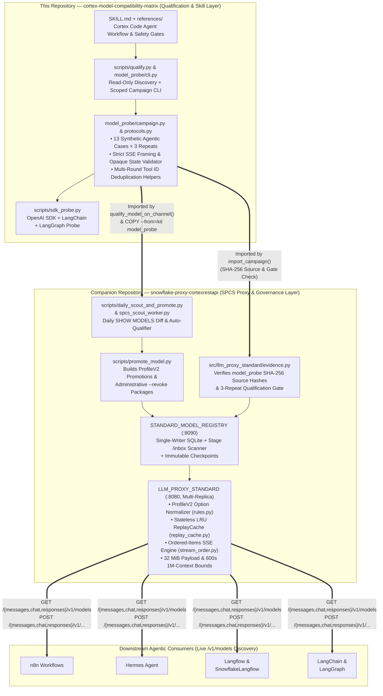
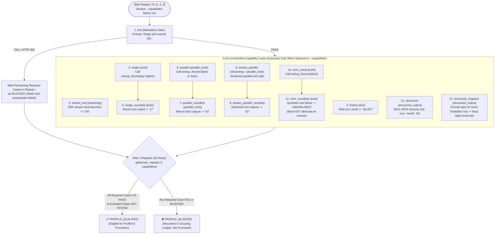
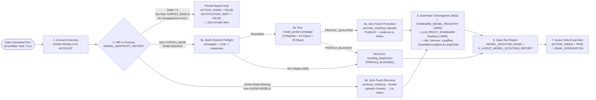

<div align="center">

# Snowflake Cortex REST API — Model Compatibility Matrix & Qualification Kit

**Deterministic Protocol Qualification Engine, Capability Gate & Cortex Code Skill for Snowflake Cortex REST APIs (`/api/v2/cortex/v1`) and Universal SPCS LLM Proxies**

[-success?style=for-the-badge)](LICENSE)
[](pyproject.toml)
[](https://docs.snowflake.com/en/user-guide/snowflake-cortex/cortex-rest-api)
[](#2-the-13-case--3-repeat-qualification-gate--capability-matrix)
[](#7-quickstart-cli-commands--skill-installation)
[](https://github.com/fbattaglieri-snowflake/snowflake-proxy-cortexrestapi)

</div>

---

> [!WARNING]
> ### IMPORTANT DISCLAIMER — NOT AN OFFICIAL SNOWFLAKE PRODUCT
> **This repository is an independent, open-source community and field-engineering qualification kit and Cortex Code skill** built on top of public **Snowflake Cortex REST APIs** (`/api/v2/cortex/v1`) and **Snowpark Container Services (SPCS)**.
> - It is **NOT an official Snowflake Inc. product** and is **NOT part of the commercial Snowflake service offering**.
> - It carries **NO official Snowflake SLA, warranty, or technical support commitment**.
> - It is provided strictly **"AS IS"** for educational, architectural, and operational validation. No private account data, credentials, or live account artifacts are included.

> [!TIP]
> ### FREE & OPEN-SOURCE LICENSE (MIT)
> This project is released under the permissive **[MIT License](LICENSE)** (**100% free and open-source**). You are free to **use, copy, modify, fork, integrate, and deploy** it in personal, internal, or commercial environments without royalty or licensing restrictions.

> [!IMPORTANT]
> ### CORE ARCHITECTURAL DEPENDENCY — [`snowflake-proxy-cortexrestapi`](https://github.com/fbattaglieri-snowflake/snowflake-proxy-cortexrestapi)
> **`cortex-model-compatibility-matrix` (`model_probe`) is the foundational qualification and evidence-verification dependency of [`snowflake-proxy-cortexrestapi`](https://github.com/fbattaglieri-snowflake/snowflake-proxy-cortexrestapi)**.
> The Universal LLM Proxy & Autonomous Model Registry directly embeds and imports `model_probe` to:
> 1. **Execute multi-channel qualification campaigns** (`messages`, `chat`, `responses`) in its daily autonomous model scouting pipeline (`scripts/daily_scout_and_promote.py` & `scripts/spcs_scout_worker.py`);
> 2. **Verify cryptographic SHA-256 runner hashes and 3-repeat capability gates** before admitting any model profile into the Single-Writer Registry (`src/llm_proxy_standard/evidence.py`);
> 3. **Gate zero-touch `ProfileV2` promotions and automatic revocations** across **n8n**, **Hermes**, **Langflow**, **SnowflakeLangflow**, and **LangChain / LangGraph**.

---

## Table of Contents

1. [Overview & Why This Qualification Kit Exists](#overview--why-this-qualification-kit-exists)
2. [Ecosystem Architecture & Dependency with `snowflake-proxy-cortexrestapi`](#1-ecosystem-architecture--dependency-with-snowflake-proxy-cortexrestapi)
3. [The 13-Case × 3-Repeat Qualification Gate & Capability Matrix](#2-the-13-case--3-repeat-qualification-gate--capability-matrix)
4. [Autonomous Daily Scouting, Promotion & Revocation Pipeline](#3-autonomous-daily-scouting-promotion--revocation-pipeline)
5. [Protocol Channels, Reference Families & Proxy `ProfileV2` Compliance](#4-protocol-channels-reference-families--proxy-profilev2-compliance)
6. [Prerequisite: Cross-Region Inference (`ANY_REGION`)](#5-prerequisite-cross-region-inference-any_region)
7. [Repository Structure](#6-repository-structure)
8. [Quickstart, CLI Commands & Skill Installation](#7-quickstart-cli-commands--skill-installation)
9. [Evidence Contract, Limits & Public Safety](#8-evidence-contract-limits--public-safety)
10. [License & Legal Disclaimer](#9-license--legal-disclaimer)

---

## Overview & Why This Qualification Kit Exists

When integrating **Snowflake Cortex REST APIs** (`/api/v2/cortex/v1`) with agentic orchestrators and universal proxies, four questions are frequently conflated—even though each one tests a completely different layer:

| Verification Layer | Question Answered | Why a Single `HTTP 200` or Catalog Row Is Not Enough |How `cortex-model-compatibility-matrix` Verifies It |
|---|---|---|---|
| **1. Catalog Visibility** | *Does `SHOW MODELS IN ACCOUNT` list the model as `CORTEX_BASE`?* | A model can appear in SQL metadata while being SQL-only, restricted to specific regions, or unavailable on REST endpoints. | `qualify.py discover` captures a point-in-time inventory of `CURRENT_ACCOUNT()`, `CURRENT_REGION()`, `CORTEX_ENABLED_CROSS_REGION`, and `SHOW MODELS IN ACCOUNT`. |
| **2. Endpoint & Protocol Reachability** | *Which REST surface (`/messages`, `/chat/completions`, or `/responses`) accepts this model and reasoning mode?* | Different model families expose different REST endpoints and reasoning parameter contracts (e.g., `reasoning_effort="none"` vs `reasoning.effort` vs `thinking`). | Separate, zero-fallback campaigns per `(model, protocol, reasoning)` with positive-control comparison on `HTTP 400` rejections. |
| **3. Agentic Protocol Correctness** | *Does the model reliably stream SSE, call single and parallel tools, preserve opaque reasoning/thinking state across turns, handle tool errors without hallucinating, and obey strict JSON schemas?* | Some models return `HTTP 200` on simple text prompts but emit duplicate `call_0` IDs across rounds, drop `encrypted_content` mid-stream, or fail parallel tool roundtrips. | **39 deterministic synthetic requests** (`3 repeats × 13 cases`) with strict SSE framing validation, opaque state preservation, and zero retries (`retries = 0`). |
| **4. Proxy, SDK & Consumer Readiness** | *Do OpenAI SDK, Anthropic SDK, LangChain, LangGraph, Langflow, SnowflakeLangflow, Hermes, and n8n work end-to-end without dropping state or truncating tool calls?* | Unmodified clients send conflicting parameters (`store: true`, empty `text: {}`, `thinking.type: "adaptive"`, or stateless tool histories). | Couples directly with **[`snowflake-proxy-cortexrestapi`](https://github.com/fbattaglieri-snowflake/snowflake-proxy-cortexrestapi)** (`ProfileV2` normalizer, `ReplayCache`, `ordered-items` SSE streamer, and `sdk_probe.py`). |

---

## 1. Ecosystem Architecture & Dependency with `snowflake-proxy-cortexrestapi`

This repository (`cortex-model-compatibility-matrix`) and [**`snowflake-proxy-cortexrestapi`**](https://github.com/fbattaglieri-snowflake/snowflake-proxy-cortexrestapi) are designed as **two halves of a unified architecture**:
- **`cortex-model-compatibility-matrix`** provides the **zero-dependency qualification engine (`model_probe`)**, deterministic protocol/SSE validators, multi-round tool-ID utilities, and the **Cortex Code agent skill (`SKILL.md`)**.
- **[`snowflake-proxy-cortexrestapi`](https://github.com/fbattaglieri-snowflake/snowflake-proxy-cortexrestapi)** provides the **SPCS Data-Plane (`LLM_PROXY_STANDARD :8080`)**, the **Single-Writer Control-Plane (`STANDARD_MODEL_REGISTRY :8090`)**, the **Zero-Touch Promotion/Revocation CLI (`promote_model.py`)**, and the **Daily Autonomous Model Scouting Orchestrator (`daily_scout_and_promote.py`)**.



### How the Two Repositories Depend on Each Other

| Integration Point in [`snowflake-proxy-cortexrestapi`](https://github.com/fbattaglieri-snowflake/snowflake-proxy-cortexrestapi) | Module / File Used from `cortex-model-compatibility-matrix` | Technical Role & Contract Enforcement |
|---|---|---|
| **1. Evidence Gate Verification (`src/llm_proxy_standard/evidence.py`)** | `model_probe.__version__`, `model_probe.campaign.{gate, required_cases, normalize_capabilities}` | Verifies that every imported campaign uses `schema_version == 2`, matches the exact `source_sha256` digests of `model_probe/*.py`, ran `repeats == 3` with `retries == 0`, and passed `gate(rows, 3, caps)`. |
| **2. Daily Autonomous Scouting (`scripts/daily_scout_and_promote.py` & `spcs_scout_worker.py`)** | `model_probe.campaign.Campaign`, `model_probe.transport.Transport` | For every new `CORTEX_BASE` model detected in `SHOW MODELS IN ACCOUNT`, probes candidate channels (`messages`, `chat`, `responses`) and runs a full `Campaign` before promoting `PROFILE_QUALIFIED` models. |
| **3. SPCS Qualification Container (`Dockerfile.qualification`)** | `COPY --from=kit model_probe /opt/proxy/model_probe` | Embeds `model_probe` directly inside the SPCS qualification and registry container image so evidence verification runs offline with zero external network dependencies. |
| **4. Zero-Touch Promotion & Revocation (`scripts/promote_model.py`)** | Consumes `PROFILE_QUALIFIED` output & `profile_sha256` | Packages qualified models into `ProfileV2` (`administrative-standard-v1`, 365-day validity, `normalize_client_options=True`) or revokes disappeared models (`--revoke`) via the Registry stage inbox (`/inbox/`). |

---

## 2. The 13-Case × 3-Repeat Qualification Gate & Capability Matrix

A full qualification campaign executes **13 deterministic synthetic test cases across 3 repeats (`39` requests total, `retries = 0`)**. Every required case must pass all 3 times (`3/3 PASS`) for the campaign to emit `status = "PROFILE_QUALIFIED"`.



### Complete Breakdown of the 13 Synthetic Qualification Cases

| # | Case Name | Capability Group | Prerequisite Case | Synthetic Assertion & Protocol Verification |
|---|---|---|---|---|
| **1** | `text` | `text` *(mandatory)* | — | Synchronous completion; exact text `"OK"`, valid stop status (`end_turn` / `stop` / `completed`), zero unexpected tool calls. |
| **2** | `stream_text` | `streaming` | `text` | Valid `text/event-stream` SSE framing, terminal sentinel/event check, delta reconstruction equals `"OK"`. |
| **3** | `history` | `text` *(mandatory)* | `text` | Multi-turn conversation memory fixture (`"Remember BLUE7."` &rarr; `"Noted."` &rarr; `"Return only the remembered code."` == `"BLUE7"`). |
| **4** | `single` | `tools` | `text` | Single tool call to `lookup_fixture` with strict argument `{"key": "alpha"}` and non-empty unique tool call ID. |
| **5** | `single_roundtrip` | `tools` | `single` | Preserves assistant turn (including `reasoning.encrypted_content` on Responses or signed `thinking` on Messages), injects tool result `"17"`, verifies final answer `"17"`. |
| **6** | `parallel` | `parallel_tools` | `text` | Emits two distinct tool calls (`alpha` and `beta`) in a single assistant turn with distinct tool call IDs. |
| **7** | `parallel_roundtrip` | `parallel_tools` | `parallel` | Pairs both synthetic tool outputs (`17` and `25`) by `tool_call_id` / `call_id` / `tool_use_id` and verifies the numeric sum `"42"`. |
| **8** | `stream_parallel` | `streaming` + `parallel_tools` | `text` | Reconstructs two parallel tool calls from incremental SSE chunks/events and validates distinct tool identities. |
| **9** | `stream_parallel_roundtrip` | `streaming` + `parallel_tools` | `stream_parallel` | Sends tool outputs for the streamed parallel tool calls and verifies the final response `"42"`. |
| **10** | `error_setup` | `tools` | `text` | Requests `lookup_fixture(key="alpha")` with instructions not to retry if the tool fails. |
| **11** | `error_roundtrip` | `tools` | `error_setup` | Returns a synthetic tool error (`is_error: true` on Messages) and verifies the model answers `"UNAVAILABLE"` instead of hallucinating a number. |
| **12** | `structured` | `structured_output` | `text` | Enforces strict JSON schema (`output_config.format` on Messages, `response_format` on Chat, `text.format` on Responses) and verifies `{"ok": true, "result": 42}`. |
| **13** | `structured_negative` | `structured_output` | `text` | Prompts the model to add an extra field named `forbidden` while strict JSON schema `additionalProperties: false` is active; verifies only `{"ok": true, "result": 42}` is emitted. |

### Capability-Scoped Qualification (`--capabilities`)

You can declare the required capability subset **before** running a campaign using `--capabilities`:

| Capability Profile | `--capabilities` Flag | Cases Executed (`× 3 Repeats`) | Total Requests | Typical Use Case |
|---|---|---|---|---|
| **Full Suite (Default)** | *(omitted)* | All 13 cases | `39` | Full agentic + structured-output model qualification. |
| **Core Agentic Suite** | `text tools parallel_tools streaming` | 11 cases (`structured` & `structured_negative` marked `NOT TESTED`) | `33` | Agentic models deployed to `LLM_PROXY_STANDARD` for tool calling and streaming. |
| **Non-Streaming Agentic** | `text tools parallel_tools` | 8 cases | `24` | Batch/synchronous tool-calling workflows. |
| **Text + Structured JSON** | `text structured_output` | 4 cases | `12` | Extraction and classification pipelines without tool calling. |
| **Text-Only SLM / Fast** | `text` | 2 cases (`text`, `history`) | `6` | Lightweight text summarization or routing models. |

---

## 3. Autonomous Daily Scouting, Promotion & Revocation Pipeline

In production deployments with [**`snowflake-proxy-cortexrestapi`**](https://github.com/fbattaglieri-snowflake/snowflake-proxy-cortexrestapi), `cortex-model-compatibility-matrix` powers the **Autonomous Daily Model Scouting Pipeline** (`scripts/daily_scout_and_promote.py` & `scripts/spcs_scout_worker.py`):



### Key Operational Rules of the Autonomous Pipeline

1. **Multi-Channel Routing Heuristics (`candidate_channels_for_model`):**
   - `claude-*` models probe `messages` first, then `chat`.
   - `openai-gpt-*` models probe `responses` first, then `chat` (`reasoning_effort="none"` and default).
   - Other model families (`glm-*`, `grok-*`, `kimi-*`, `gemini-*`, `mistral-*`, `qwen-*`) probe `chat` (default and `reasoning_effort="none"`), then `responses`, then `messages`.
   - For Chat models that pass with default reasoning, an additional probe tests whether `reasoning_effort` (`low`/`medium`/`high`) is supported so `ProfileV2.constraints` exposes the exact enum to downstream consumers.
2. **Zero-Touch Promotion & Automatic Removal:**
   - Passing models are packaged as `ProfileV2` (`administrative-standard-v1`, 365-day validity) and uploaded to `@<DB>.<SCHEMA>.<STAGE>/inbox/`.
   - Active models that disappear from `SHOW MODELS IN ACCOUNT` are automatically revoked via `{"revoke": {"id": "<model>", "expected_revision": "<rev>", ...}}` in the same stage inbox.
   - `STANDARD_MODEL_REGISTRY` ingests inbox packages within 30s and writes an immutable `checkpoint-<20d-gen>-<sha256>.json`, which all `LLM_PROXY_STANDARD` replicas pick up within 30s—**requiring zero service restarts**.
3. **Always-On Audit Persistence with Action-Only Email Notification:**
   - Every run writes a full JSON + Markdown report to `MODEL_SCOUTING_RUNS` (queryable via `V_LATEST_MODEL_SCOUTING_REPORT`).
   - Email notifications via `SYSTEM$SEND_SNOWFLAKE_NOTIFICATION` (`EMAIL_INTEGRATION`) are sent **strictly when `ACTION_TAKEN = TRUE`** (new model qualified/promoted/blocked, or disappeared model revoked). Quiet days (`ACTION_TAKEN = FALSE`) produce zero email noise.

---

## 4. Protocol Channels, Reference Families & Proxy `ProfileV2` Compliance

### Three Native API Channels Validated by the Kit & Served by the Proxy

| Protocol Identifier (`--protocol`) | Upstream Cortex REST Endpoint | Proxy Base URL (`:8080`) | Proxy Discovery & Inference Routes | Typical Qualified Model Families |
|---|---|---|---|---|
| **`messages`** | `POST /api/v2/cortex/v1/messages` | `http://<proxy>:8080/messages` *(or `/messages/v1`)* | `GET /messages/v1/models`<br/>`POST /messages/v1/messages` | **Anthropic Claude:**<br/>`claude-haiku-5-5`, `claude-opus-5-5`, `claude-sonnet-5-5` |
| **`chat`** | `POST /api/v2/cortex/v1/chat/completions` | `http://<proxy>:8080/chat/v1` | `GET /chat/v1/models`<br/>`POST /chat/v1/chat/completions` | **OpenAI Chat & Frontier Chat:**<br/>`glm-5.3`, `grok-4.6`, `grok-4.7`, `kimi-k3`, `openai-gpt-6-luna`, `openai-gpt-6-sol` |
| **`responses`** | `POST /api/v2/cortex/v1/responses` | `http://<proxy>:8080/responses/v1` | `GET /responses/v1/models`<br/>`POST /responses/v1/responses` | **OpenAI Reasoning Responses:**<br/>`openai-gpt-6-astra`, `openai-gpt-6.1-sol`, `openai-gpt-6.1-terra` |

> [!NOTE]
> **Why Catalog Presence (`SHOW MODELS IN ACCOUNT`) Does Not Imply REST Qualification:**
> Models listed as `CORTEX_BASE` in `SHOW MODELS IN ACCOUNT` (such as internal routing/decision models or models not yet enabled on the public Cortex REST surface) can return `HTTP 400` across all three REST endpoints even when `CORTEX_ENABLED_CROSS_REGION = 'ANY_REGION'` is active. This kit classifies those models as `PROFILE_BLOCKED` with full request-ID evidence and prevents them from polluting proxy `/models` catalogs.

### Proxy Compliance & Normalization Matrix (`snowflake-proxy-cortexrestapi`)

When a model passes this kit (`PROFILE_QUALIFIED`) and is promoted to [**`snowflake-proxy-cortexrestapi`**](https://github.com/fbattaglieri-snowflake/snowflake-proxy-cortexrestapi) as a `ProfileV2` entry (`normalize_client_options = True`), the proxy enforces six production guarantees across all connected consumers (**n8n**, **Hermes**, **Langflow**, **SnowflakeLangflow**, **LangChain / LangGraph**):

| Proxy Subsystem | Protocol(s) | What `cortex-model-compatibility-matrix` & `snowflake-proxy-cortexrestapi` Enforce Together |
|---|---|---|
| **1. Flexible Token Budgets (`1..128000`)** | `messages`, `chat`, `responses` | Qualification probes use a bounded `2048`-token cap for synthetic tests, while published `ProfileV2` profiles accept `1..128000` (clamping values above the maximum, defaulting `max_tokens = 4096` on Messages when omitted, and leaving `max_output_tokens` unset on Responses when omitted so long reasoning blocks never truncate downstream `function_call` JSON arguments). |
| **2. Ordered-Items SSE & `encrypted_content` Finalization** | `responses` | Enables `response_stream = "ordered-items"` (`stream_order.py` + `protocol.py`). Accepts empty `""` or provisional initial `encrypted_content` on `response.output_item.added`, requires non-empty finalized `encrypted_content` on `response.output_item.done` matching `response.completed`, backfills `response.output_item.added`, and allows one optional trailing `[DONE]` sentinel after `response.completed`. |
| **3. Reasoning & Extended Thinking Normalization** | `messages`, `chat`, `responses` | • **Chat:** Resolves `max_tokens` + `max_completion_tokens` conflicts; forces `reasoning_effort="none"` on models that require it (`openai-gpt-6-luna`, `openai-gpt-6-sol`); strips `reasoning_effort` on Chat models that reject it (`grok-*`, `kimi-*`, `glm-*`); exposes `metadata.constraints` on `GET /chat/v1/models` so `Langflow` and `SnowflakeLangflow` pass `reasoning_effort` via `extra_body` only when supported.<br/>• **Responses:** Forces `store=false`, injects `include=["reasoning.encrypted_content"]`, strips empty `"text": {}` and `prompt_cache_retention`, strips `temperature`/`top_p` on reasoning models, and clamps out-of-domain `reasoning.effort` (`"none"`/`"minimal"` &rarr; `"low"`).<br/>• **Messages:** Strips unsupported `thinking.type` blocks (e.g. `"adaptive"` sent before profile negotiation) and paired `output_config.effort`; when `thinking.type == "enabled"`, strips `temperature`/`top_p` and guarantees `max_tokens > thinking.budget_tokens`. |
| **4. Stateless Tool-Loop `ReplayCache`** | `messages`, `responses` | Bounded LRU cache (`max_entries=512`, `ttl=3600s`) keyed by `call_id` / `tool_use.id`. Automatically rehydrates `reasoning.encrypted_content` (Responses) and `thinking` / `signature` / `redacted_thinking` blocks (Messages) when stateless orchestrators (such as unpatched n8n Agent engine JSON serialization) drop them between tool turns. |
| **5. Multi-Round Tool Call ID Deduplication** | `messages`, `chat`, `responses` | Tested by `reused_tool_ids()` and `multiround_followup()` in `model_probe/protocols.py` and enforced in `rules.py`: models that number tool calls sequentially per turn (`call_0..call_N` on Round 1 and again `call_0..call_N` on Round 2) are validated per open batch and automatically renamed across closed turns (`call_0` &rarr; `call_0_r2`). |
| **6. 1M+ Token Context & Compression Bounds** | `messages`, `chat`, `responses` | Production proxy defaults `PROXY_MAX_BODY = 32 MiB`, `PROXY_MAX_RESPONSE = 32 MiB`, `PROXY_DEADLINE = 600s` (10 min), and `httpx.Timeout(180, connect=10, write=60, pool=5)`, paired with `reasoning={"effort": "low", "summary": "auto"}` on auxiliary context-compression requests to prevent `HTTP 413` payload rejections and mid-stream timeouts on 1M-token conversations. |

---

## 5. Prerequisite: Cross-Region Inference (`ANY_REGION`)

For the broadest model availability across `Messages`, `Chat`, and `Responses`, configure **Cross-Region Inference** (`ANY_REGION`) when your organization's data-residency and compliance policies allow it:

```sql
-- 1. Inspect the current account-level parameter:
SHOW PARAMETERS LIKE 'CORTEX_ENABLED_CROSS_REGION' IN ACCOUNT;

-- 2. Only after explicit administrator approval (requires ACCOUNTADMIN):
ALTER ACCOUNT SET CORTEX_ENABLED_CROSS_REGION = 'ANY_REGION';
```

- **The qualification kit never executes `ALTER ACCOUNT` automatically.**
- For workloads with strict regional boundaries, configure the appropriate documented scope (such as `AWS_EU`, `AWS_US`, `AWS_GLOBAL`, `AZURE_GLOBAL`, or `GCP_GLOBAL`).
- See [references/cross-region.md](references/cross-region.md) and the [Snowflake Cross-Region Inference documentation](https://docs.snowflake.com/en/user-guide/snowflake-cortex/cross-region-inference).

---

## 6. Repository Structure

```text
cortex-model-compatibility-matrix/
├── LICENSE                                         # MIT License (Free & Open Source) + Non-Official Disclaimer
├── README.md                                       # Architecture, visual schematics, matrix & CLI guide
├── SKILL.md                                        # Cortex Code skill definition, workflow & proxy compliance gates
├── pyproject.toml                                  # Package metadata & optional SDK dependencies (.[sdk])
├── model_probe/                                    # Zero-dependency standard-library qualification engine
│   ├── __init__.py                                 # Package version (0.2.0) verified by proxy evidence gate
│   ├── cli.py                                      # CLI entrypoint (cortex-model-test / qualify.py)
│   ├── campaign.py                                 # 13-case × 3-repeat runner, capability gates & private evidence
│   ├── protocols.py                                # Chat, Messages & Responses payloads, SSE decoders & multi-round IDs
│   └── transport.py                                # Strict TLS/loopback/SPCS-internal HTTP transport & secret redaction
├── scripts/
│   ├── qualify.py                                  # Standalone CLI wrapper executable from any directory
│   └── sdk_probe.py                                # Optional 4-suite × 3-repeat OpenAI / LangChain / LangGraph probe
├── references/
│   ├── protocol.md                                 # Qualification Contract v2, capability matrix & proxy release checklist
│   └── cross-region.md                             # Cross-Region Inference (ANY_REGION) guidance & boundaries
├── examples/
│   ├── Dockerfile                                  # Container image recipe for isolated SPCS qualification jobs
│   └── spcs-job.yaml                               # Template for running service-rest probes inside SPCS
├── tests/                                          # 36 offline unit tests (synthetic fixtures, zero network required)
│   ├── test_probe.py                               # Protocol, SSE framing, multi-round tool ID & safety tests
│   ├── test_profiles.py                            # Capability scoping & SPCS internal proxy destination tests
│   └── test_sdk_offline.py                         # Offline SDK / LangChain / LangGraph verification tests
└── .github/workflows/
    └── offline.yml                                 # GitHub Actions CI running offline unit tests on every push
```

---

## 7. Quickstart, CLI Commands & Skill Installation

### 7.1 Run the Offline Unit Test Suite (`36/36 PASS`, Zero Network / Zero Credentials)

Requirements: Python 3.11+. The core REST qualification runner uses only the Python standard library.

```bash
git clone https://github.com/fbattaglieri-snowflake/cortex-model-compatibility-matrix.git
cd cortex-model-compatibility-matrix
python3 -m unittest discover -s tests -v
python3 scripts/qualify.py --help
```

### 7.2 Install as a Cortex Code Skill

Clone the repository into your Cortex Code skills directory (or link your local skill entry point to the cloned repository path so `SKILL.md`, `references/`, and `scripts/` stay together):

```bash
git clone https://github.com/fbattaglieri-snowflake/cortex-model-compatibility-matrix.git \
  ~/.snowflake/cortex/skills/cortex-model-compatibility-matrix
```

Example prompt in Cortex Code:

> *"Use the `cortex-model-compatibility-matrix` skill to qualify `<MODEL_ID>` on my explicitly selected account across `responses` and `chat`, verify proxy `ProfileV2` compatibility, and show the capability matrix before promoting."*

### 7.3 Step 1 — Read-Only Account & Model Discovery (`discover`)

```bash
python3 scripts/qualify.py discover \
  --connection <YOUR_SNOW_CLI_CONNECTION> \
  --host <your-org>-<your-account>.snowflakecomputing.com \
  --expected-account <YOUR_ACCOUNT_LOCATOR> \
  --output /path/to/private-results/inventory.json
```

### 7.4 Step 2 — Run a Direct Cortex REST Qualification Campaign (`run --live`)

Load your Programmatic Access Token (`PAT`) into an environment variable (never pass secrets inline on the command line) and run the 3-repeat qualification suite:

```bash
# Qualify on OpenAI Responses (/api/v2/cortex/v1/responses)
python3 scripts/qualify.py run --live \
  --base-url https://<your-org>-<your-account>.snowflakecomputing.com/api/v2/cortex/v1 \
  --expected-host <your-org>-<your-account>.snowflakecomputing.com \
  --expected-account <YOUR_ACCOUNT_LOCATOR> \
  --inventory /path/to/private-results/inventory.json \
  --model <YOUR_MODEL_ID> \
  --protocol responses \
  --scope direct-rest \
  --token-env SNOWFLAKE_PAT \
  --output /path/to/private-results/responses-default
```

- Use `--protocol messages` for Anthropic Messages (`/api/v2/cortex/v1/messages`) or `--protocol chat` for OpenAI Chat Completions (`/api/v2/cortex/v1/chat/completions`).
- To test a specific reasoning setting (e.g., `--reasoning none` on Chat models that require it), run a separate campaign into a new `--output` directory.
- To scope the campaign to specific capabilities (e.g., excluding structured output if a model is intended only for tool-calling + streaming), declare `--capabilities text tools parallel_tools streaming` before running.

### 7.5 Step 3 — Qualify Through an Existing Proxy (`--scope proxy`)

```bash
# Loopback proxy (http://127.0.0.1:8080)
python3 scripts/qualify.py run --live \
  --base-url http://127.0.0.1:8080/v1 \
  --expected-host 127.0.0.1 \
  --scope proxy --local-proxy \
  --model <YOUR_MODEL_ID> --protocol chat \
  --output /path/to/private-results/proxy-chat

# Internal SPCS Proxy Service (credential-free internal DNS *.svc.spcs.internal)
python3 scripts/qualify.py run --live \
  --scope proxy --internal-proxy \
  --base-url http://llm-proxy-standard.<namespace>.svc.spcs.internal:8080/responses/v1 \
  --expected-base-url http://llm-proxy-standard.<namespace>.svc.spcs.internal:8080/responses/v1 \
  --expected-host llm-proxy-standard.<namespace>.svc.spcs.internal \
  --model <YOUR_MODEL_ID> --protocol responses \
  --capabilities text tools parallel_tools streaming \
  --output /path/to/private-results/spcs-proxy-responses
```

### 7.6 Step 4 — Optional SDK / LangChain / LangGraph Verification (`sdk_probe.py`)

```bash
python3 -m venv .venv && .venv/bin/pip install -e '.[sdk]'
.venv/bin/python scripts/sdk_probe.py --live \
  --campaign /path/to/private-results/chat-default \
  --expected-host <your-org>-<your-account>.snowflakecomputing.com \
  --token-env SNOWFLAKE_PAT \
  --output /path/to/private-results/sdk-probe.json
```

### 7.7 Step 5 — Zero-Touch Promotion or Revocation in [`snowflake-proxy-cortexrestapi`](https://github.com/fbattaglieri-snowflake/snowflake-proxy-cortexrestapi)

Once a model achieves `PROFILE_QUALIFIED` (or needs to be revoked when retired from the account), use `scripts/promote_model.py` in [`snowflake-proxy-cortexrestapi`](https://github.com/fbattaglieri-snowflake/snowflake-proxy-cortexrestapi):

```bash
# Promote a qualified model zero-touch (no service restarts)
python /path/to/snowflake-proxy-cortexrestapi/scripts/promote_model.py \
  --model <YOUR_MODEL_ID> \
  --protocol <chat|responses|messages> \
  --account <YOUR_ACCOUNT_LOCATOR> \
  --upstream https://<your-org>-<your-account>.snowflakecomputing.com/api/v2/cortex/v1 \
  --artifact <64-hex-proxy-artifact-digest> \
  --expected-revision <current-registry-revision> \
  --approver <YOUR_ADMIN_IDENTITY> \
  --output-dir /path/to/private-results/promotion-package \
  --stage-inbox @<YOUR_DB>.<YOUR_SCHEMA>.<YOUR_STAGE>/inbox \
  --connection <YOUR_SNOW_CLI_CONNECTION>

# Revoke a retired/disappeared model zero-touch
python /path/to/snowflake-proxy-cortexrestapi/scripts/promote_model.py \
  --revoke \
  --model <RETIRED_MODEL_ID> \
  --account <YOUR_ACCOUNT_LOCATOR> \
  --expected-revision <current-registry-revision> \
  --approver <YOUR_ADMIN_IDENTITY> \
  --reason "Model retired from account" \
  --output-dir /path/to/private-results/revoke-package \
  --stage-inbox @<YOUR_DB>.<YOUR_SCHEMA>.<YOUR_STAGE>/inbox \
  --connection <YOUR_SNOW_CLI_CONNECTION>
```

---

## 8. Evidence Contract, Limits & Public Safety

- **Append-Only Private Evidence (`0700` dirs / `0600` files):** Every campaign writes `manifest.json`, `case-001.json .. case-039.json`, and `summary.json` using exclusive file creation (`O_CREAT | O_EXCL`). Secrets are automatically redacted (`[REDACTED]`), and existing evidence directories are never overwritten.
- **Keep Evidence Private:** Even with token redaction, evidence files contain account metadata, `x-snowflake-request-id` headers, and raw response payloads. **Never commit live campaign directories to a public repository.**
- **Resource & Cost Guards:** Each campaign enforces a default ceiling of `60` REST requests (`40` for `sdk_probe.py`), `2048` output tokens per synthetic probe request, `2 MB` per probe response, and a `60s` socket timeout with `retries = 0`.
- **What Qualification Does and Does Not Certify:** `PROFILE_QUALIFIED` proves that the 3-repeat synthetic contract held for that `(model, protocol, reasoning, capabilities)` tuple. See [references/protocol.md](references/protocol.md) for full details on out-of-scope dimensions (such as vision/audio inputs, load testing, or SQL `AI_COMPLETE`).

---

## 9. License & Legal Disclaimer

### Open-Source License (MIT)
This project is licensed under the **[MIT License](LICENSE)** — a permissive, free software license. You may freely use, copy, modify, merge, publish, distribute, sublicense, and/or sell copies of the software, subject only to preserving the copyright and permission notice in [`LICENSE`](LICENSE).

### Non-Official Product Disclaimer
> [!IMPORTANT]
> **No Official Snowflake Endorsement or Support:**
> This repository and all accompanying scripts, skill definitions, container templates, and documentation are community-contributed reference materials. They are **not** authored, certified, warranted, or supported by **Snowflake Inc.** as part of any commercial Snowflake product or service agreement. All trademarks and registered trademarks are the property of their respective owners.
